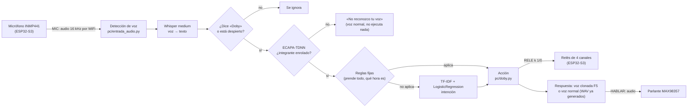

# Doby: asistente de voz que solo obedece a su grupo

Doby es un asistente de voz en español que controla cuatro aparatos de 110 V (ventilador, bombillo, cautín y plancha de cabello). Solo obedece a los integrantes enrolados y les responde con su propia voz clonada.

Todo el procesamiento de voz corre **en el PC, sin internet**. La ESP32-S3 solo escucha, reproduce y conmuta los relés.

Es el proyecto de aplicaciones de Deep Learning de la **Universidad de Cundinamarca, sede Facatativá**.

**Integrantes:** Jean Paul Miranda, Harry Raigozo y Lina Tatiana Maldonado.

---

## Qué hace

1. Duerme hasta que alguien dice **«Hola Doby»**.
2. El PC pasa la voz a texto con **Whisper medium** (local).
3. Verifica con **ECAPA-TDNN** que quien habla sea un integrante enrolado.
4. Clasifica la intención con **TF-IDF + LogisticRegression**.
5. Manda la orden por WiFi a la **ESP32-S3**, que es el servidor TCP, y la ESP32 activa el relé.
6. Responde por el parlante (MAX98357):
   - con la **voz clonada (F5-TTS)** del integrante que lo despertó;
   - con la **voz normal**, que son audios pregenerados con gTTS, cuando no hay un integrante verificado.

También responde **«Doby, ¿qué hora es?»** con la hora de Colombia («Son las nueve y veintitrés de la noche.»).

## Flujo



En texto: micrófono (ESP32) → WiFi → PC: detección de voz → Whisper → «¿hay "Doby" o está despierto?» → verificación ECAPA → reglas fijas o clasificador → acción → relé (ESP32) + respuesta hablada (ESP32).

## Materiales

| Componente | Uso |
|---|---|
| ESP32-S3 N16R8 con MicroPython | Servidor TCP: micrófono, parlante y relés |
| Micrófono I2S INMP441 | Captura de voz (16 kHz) |
| Amplificador I2S MAX98357 + parlante de 1.5 W | Voz de Doby |
| Módulo de relés de 4 canales (activo en bajo) | Ventilador, cautín, bombillo y plancha de cabello a 110 V |
| PC con Windows, Python 3.11 y GPU NVIDIA (se probó con 8 GB) | Whisper, ECAPA, clasificador y voces |
| Red WiFi de 2.4 GHz (por ejemplo, el punto de acceso de un celular) | Une el PC y la ESP32 |

Pines, protocolo y seguridad eléctrica: [CONEXIONES.md](CONEXIONES.md).

## Modelos

| Modelo | Qué hace en Doby | ¿Lo entrenamos? |
|---|---|---|
| **Whisper medium** (faster-whisper) | Voz → texto, en español. En GPU float16 o, si falla, en CPU int8. Descarta tramos sin voz y frases que Whisper inventa con el ruido. | No: preentrenado, solo configurado (`pc/stt.py`). |
| **ECAPA-TDNN** (SpeechBrain, `spkrec-ecapa-voxceleb`) | Convierte la voz en un vector de 192 números. Doby compara con el coseno contra el centroide de cada integrante. | No se entrenó la red: **se enroló** (un centroide por persona) y se calibraron los umbrales con grabaciones del INMP441 (`entrenamiento/evaluar_hablantes.py` y `enrolar_hablantes.py`). |
| **F5-TTS** (F5-Spanish) | Genera, **antes** de usar Doby, todas sus frases con la voz de cada integrante a partir de un clip de referencia de 6 a 12 s (zero-shot). Cada audio se valida con Whisper. | No: zero-shot. |
| **TF-IDF + LogisticRegression** (scikit-learn) | Texto → una de 8 intenciones. | **Sí** (`entrenamiento/entrenar_base.py`). |
| gTTS | La voz normal: genera una sola vez los WAV de `voz_cache/` (necesita internet esa vez). | No. |

### Clasificador de intenciones

- **Modelo:** TF-IDF (palabras de 1 a 2 + caracteres `char_wb` de 2 a 5) + `LogisticRegression(class_weight="balanced")`.
- **Intenciones:** `encender`, `apagar`, `apagar_todo`, `descansar`, `consultar_estado`, `saludo`, `agradecer`, `fuera_de_dominio`.
- **Datos:** frases de MASSIVE (es-ES), frases sintéticas por plantillas y frases generadas y revisadas por el grupo. Se reparten 80/20 estratificado: 890 de entrenamiento y 223 de prueba.

#### Resultados del modelo en uso

Fuente: `resultados/base_metricas.txt` y `modelos/base_info.json`. Se entrenó el 13-oct-2026 y es el candidato `candidato_aparatos2`: su `base_metricas.txt` es idéntico al del modelo en uso.

| Métrica (test, 223 frases) | Valor |
|---|---|
| Accuracy | **0.9776** |
| F1 macro | **0.9759** |
| Acierto por origen | MASSIVE 57/60 (0.950) · sintéticas 117/117 (1.000) · generadas 44/46 (0.957) |
| Frases de la demo (`datos/frases_demo.txt`) | 22/22 |
| Características TF-IDF | 7889 |

| Intención | Precisión | Recall | F1 | Frases en test |
|---|---|---|---|---|
| saludo | 0.905 | 0.950 | 0.927 | 20 |
| encender | 1.000 | 1.000 | 1.000 | 37 |
| apagar | 0.973 | 1.000 | 0.986 | 36 |
| apagar_todo | 0.952 | 0.952 | 0.952 | 21 |
| descansar | 1.000 | 1.000 | 1.000 | 19 |
| consultar_estado | 1.000 | 1.000 | 1.000 | 21 |
| agradecer | 1.000 | 0.944 | 0.971 | 18 |
| fuera_de_dominio | 0.980 | 0.961 | 0.970 | 51 |

El modelo falló 5 de las 223 frases de test:

| Frase | Real | Predicción | Confianza |
|---|---|---|---|
| «eres el mejor» | agradecer | fuera_de_dominio | 0.34 |
| «como va todo» | saludo | apagar_todo | 0.35 |
| «que cancion escucho mas» | fuera_de_dominio | saludo | 0.37 |
| «que cosas no puedes hacer» | fuera_de_dominio | saludo | 0.20 |
| «apaga todas las cosas» | apagar_todo | apagar | 0.46 |

Las 5 quedan por debajo del umbral de 0.5, así que Doby no actúa a ciegas: aplica los respaldos de abajo o dice «No te entendí».

Matriz de confusión: `resultados/base_matriz_confusion.png` (y `.csv`).

#### Cambio de aparatos: el modelo anterior y los dos candidatos

Fuente: `resultados/candidato_aparatos*/comparacion_aparatos.txt`, generado con `entrenamiento/comparar_modelo_aparatos.py`.

Cuando el carro se cambió por el cautín y la plancha se reentrenó el clasificador. Hubo dos candidatos y se adoptó `candidato_aparatos2`.
- **Modelo anterior (24-sep):** accuracy 0.9865 y F1 macro 0.9871 en su propio test (220/223 aciertos). Su matriz está en `resultados/base_matriz_confusion_anterior.*`.

| | `candidato_aparatos` | `candidato_aparatos2` (en uso) |
|---|---|---|
| Test nuevo: accuracy / F1 macro | 0.9730 / 0.9756 (222 frases) | 0.9776 / 0.9759 (223 frases) |
| Modelo anterior en ese mismo test | 0.9910 / 0.9931 | 0.9955 / 0.9966 |
| Solo frases que el modelo anterior **no** vio al entrenar: anterior → candidato | 0.9847 → **0.9924** (131 frases) | 0.9925 → **1.0000** (133 frases) |
| Demo (22 frases) | 22/22, ninguna con confianza < 0.5 | 22/22, ninguna con confianza < 0.5 |
| Órdenes con cautín y plancha **con verbo** (31): mediana / mínima de confianza | 0.81 / 0.53 | 0.80 / 0.54 |
| Aparato **sin verbo** («La plancha.», 8 frases) | todas < 0.5 (no encienden nada) | todas < 0.5 |

> El modelo anterior sale más alto en el test nuevo porque **había visto** 90 o 91 de esas frases al entrenar. Por eso la comparación justa es la fila de las frases que no vio.

Con transcripciones reales de Whisper, las órdenes mal transcritas («pre el cautín», «paga el soldador») suelen quedar bajo 0.5. En ese caso decide el respaldo por verbo y aparato de `pc/doby.py`, o Doby pide repetir.

Si la confianza del modelo es menor que **0.5**, Doby intenta estos respaldos, en orden:
1. Verbo explícito + aparato («prende… ventilador»).
2. Palabras implícitas («calor» → enciende el ventilador, «frío» → lo apaga, «oscuro» → enciende el bombillo).
3. Si la frase traía un saludo, lo toma como saludo.

Si ninguno aplica, responde «No te entendí, ¿me lo repites?».

## Cómo se comporta (según `pc/doby.py` y `pc/config.py`)

### Verificación de hablante (solo en modo voz)

- **Dormido:** ignora toda frase sin «Doby». Con «Hola Doby» verifica la voz:
  - **Aceptado** (similitud ≥ umbral alto): despierta, y ese integrante queda como *persona activa*.
  - **Zona gris** (entre el umbral bajo y el alto): dice «No te reconocí bien, llámame otra vez.» con la voz normal. Si el segundo «Hola Doby» llega antes de 15 s, decide con los dos audios unidos.
  - **Desconocido:** dice «No reconozco tu voz.» con la voz normal y **no ejecuta nada**.
- **Despierto:** también se verifica **cada orden**.
  - Se acepta si el integrante más parecido es la persona activa y su similitud es ≥ `UMBRAL_SESION`.
  - Si no se acepta, responde «No reconozco tu voz.» y no ejecuta la orden.
  - Para cambiar de persona hay que decir «Hola Doby…».
- Si el audio es demasiado corto para verificar, responde «No te entendí» con la voz de la persona activa.
- En **modo texto** (`--texto`) no hay verificación.

### Voz de las respuestas (`VOZ_CLONADA = True`)

- **Integrante verificado:** siempre su voz clonada.
  - Si le falta un audio, usa otra versión aprobada suya, luego su frase genérica («Listo.») y, si tampoco está, silencio. Queda registrado en `logs/` y **nunca usa la voz de otra persona**.
- **Sin integrante verificado:** la voz normal, solo desde los WAV que ya existen en `voz_cache/`. Doby nunca llama a gTTS mientras corre.
- **La hora:** con la voz del integrante. Si a su voz le falta esa hora, dice la hora **completa** con la voz normal (nunca mezcla voces).

### Reglas fijas (antes del clasificador)

- **«Prende todo»:** verbo de encender + «todo/todos/todas», sin nombrar un aparato. Enciende los 4.
- **«¿Qué hora es?»:** es una regla fija en `doby.py`, **no una intención del clasificador**.
  - Tras quitar «Doby» y el saludo debe quedar exactamente «qué hora es», solo con palabras de cortesía («por favor», «dime», «mira»…).
  - «¿A qué hora es la función?» sigue yendo al clasificador.
  - Si Doby ya está despierto, funciona sin decir «Doby».
  - Usa la hora del PC en America/Bogota, en formato de 12 horas a la colombiana («Es la una en punto de la tarde.»). Cada una de las 1440 horas del día es una frase pregenerada por voz.
- **Respuesta a «¿Cuál quieres que encienda/apague?»:** vale para la frase siguiente si empieza en los 8 s después de la pregunta.

### Otras acciones

- «Apaga todo» apaga los 4 relés y Doby se duerme.
- «Descansa» lo duerme.
- «¿Qué está encendido?» dice el estado.
- También responde saludos y agradecimientos.
- «Apágalo» actúa sobre el último aparato mencionado. Para **encender** un aparato que calienta, si la frase nombra otra cosa, pregunta cuál.

Seguridad del cautín y la plancha (apagado automático a los 10 min, al cerrar Doby y en la ESP32 sin PC): [CONEXIONES.md](CONEXIONES.md#seguridad-de-los-aparatos-que-se-calientan-cautín-y-plancha).

## Estructura

```
pc/                 Doby (corre en el PC): doby.py y sus módulos, config.py
esp32/              Firmware MicroPython: main.py (+ secretos.py, que NO se sube; plantilla secretos.ejemplo.py)
entrenamiento/      Clasificador, grabación, enrolamiento y generación de voces
pruebas/            Pruebas con y sin ESP32 (las que corren en la ESP32 dicen "CORRE EN LA ESP32")
datos/              Frases del clasificador (train/test/sinteticas/generadas, frases_demo)
modelos/            base.joblib + base_info.json (clasificador). ecapa-voxceleb/, f5-spanish/ y hablantes/ NO se suben
resultados/         Métricas y matrices de confusión del clasificador
voz_cache/ ...      Carpetas de audio: vacías en el repositorio, cada una con su LEEME.md
```

## Qué NO está en el repositorio

- **Ningún audio** (voces grabadas, voces clonadas ni voz normal).
- **Las huellas de voz:** embeddings, centroides, umbrales calculados y `modelos/hablantes/`. Son datos biométricos.
- **Los modelos descargados:** Whisper, ECAPA y F5-Spanish.
- **MASSIVE.**
- **`esp32/secretos.py`.**

Cada carpeta de audio o de huellas tiene un `LEEME.md` con qué archivos van, su nombre, su formato y el comando que los genera.

## Instalación

### 1. Python del sistema (Doby)

```powershell
py -m pip install torch==2.11.0 torchaudio==2.11.0 --index-url https://download.pytorch.org/whl/cu128
py -m pip install -r requirements.txt
```

**POR VERIFICAR:** el comando exacto de torch para tu GPU y driver (se probó con `torch 2.11.0+cu128`). Compruébalo con `py -c "import torch; print(torch.cuda.is_available())"`.

### 2. Modelos descargados

| Modelo | Dónde va | Cómo |
|---|---|---|
| Whisper medium (`Systran/faster-whisper-medium`) | caché de Hugging Face | Se descarga solo la primera vez que corre `pc/stt.py` (necesita internet esa vez). |
| ECAPA (`speechbrain/spkrec-ecapa-voxceleb`) | `modelos/ecapa-voxceleb/` | **POR VERIFICAR:** `huggingface-cli download speechbrain/spkrec-ecapa-voxceleb --local-dir modelos/ecapa-voxceleb`. El código carga con `HF_HUB_OFFLINE=1` y nunca descarga solo. Comprobación: `py -c "import sys; sys.path.insert(0,'entrenamiento'); import hablantes as h; h.cargar_modelo()"`. |
| F5-Spanish (`jpgallegoar/F5-Spanish`: `model_1200000.safetensors` y `vocab.txt`) + vocoder Vocos (`vocos-mel-24khz`) | `modelos/f5-spanish/` y `modelos/f5-spanish/vocos-mel-24khz/` | **POR VERIFICAR** el repositorio exacto del vocoder (probablemente `charactr/vocos-mel-24khz`). Solo hace falta para generar voces clonadas. |

### 3. MASSIVE (solo para reentrenar el clasificador)

`entrenamiento/preparar_datos.py` lee `datos/massive/es-ES.jsonl` (MASSIVE 1.1 de Amazon, locale es-ES).

- Se descarga desde el repositorio oficial (`github.com/alexa/massive`) y de ahí se copia `data/es-ES.jsonl`.
- **POR VERIFICAR** la URL exacta del archivo.
- Licencia: **CC BY 4.0, POR VERIFICAR** en el repositorio oficial. Si se usa, hay que citar a los autores.

### 4. Entorno de F5 (solo para generar voces clonadas)

Las instrucciones están en `requirements_f5.txt`. Es un `venv_f5` con `--system-site-packages`.

## Puesta en marcha desde cero

Usa nombres de carpeta en minúsculas y sin tildes (`persona1`, `persona2`…). Son los nombres con que Doby enrola y busca las voces.

1. **Placa:**
   - Copia `esp32/secretos.ejemplo.py` como `secretos.py` y escribe tu red.
   - Sube `secretos.py` y `main.py` a la ESP32 con Thonny.
   - Pon en `IP_ESP32` (`pc/config.py`) la IP que imprime la placa.
   - Comprueba con `py pruebas/prueba_protocolo.py`.
2. **Clasificador:** ya viene en `modelos/base.joblib`. Para reentrenarlo:
   `py entrenamiento/generar_sinteticas.py` → `py entrenamiento/preparar_datos.py` → `py entrenamiento/entrenar_base.py`.
3. **Grabar y enrolar** a cada integrante con el micrófono de la ESP32:
   - `py entrenamiento/grabar_inmp441.py --persona persona1 --bloque A` (15 «Hola Doby») y `--bloque B` (22 órdenes).
   - `py entrenamiento/grabar_ruido.py --lugar cuarto`.
   - `py entrenamiento/evaluar_hablantes.py` y después `py entrenamiento/enrolar_hablantes.py`. Esto crea `modelos/hablantes/`.
   - ⚠️ `evaluar_hablantes.py` **no está en este repositorio**, y `enrolar_hablantes.py` lo necesita.
   - Las frases de cada bloque están en `datos/guion_voces/guion_voces.json`.
4. **Voz normal** (internet una sola vez): `py pc/tts.py` y `py entrenamiento/generar_hora.py --normal`.
5. **Voces clonadas:**
   - Prepara las referencias de cada integrante (ver `voz_comparacion_f5/referencias/LEEME.md`).
   - Copia `entrenamiento/referencias_voz_f5.ejemplo.json` como `entrenamiento/referencias_voz_f5.json` y anota ahí los clips.
   - `venv_f5\Scripts\python.exe entrenamiento/generar_voces_f5.py`
   - `venv_f5\Scripts\python.exe entrenamiento/generar_hora.py --persona persona1`
   - Revisa de oído lo que quede en `_revisar_de_oido/` (`--aprobar` / `--rechazar`).
6. **Comprobar que no falte ningún audio:** `py pruebas/verificar_cobertura.py`.
7. **Arrancar Doby:** `py pc/doby.py`. Con `--texto` las frases se escriben en lugar de decirse.

Sin voces clonadas, se puede poner `VOZ_CLONADA = False` en `pc/config.py`: Doby habla siempre con la voz normal.

## Pruebas

| Comando | Necesita |
|---|---|
| `py pruebas/prueba_ordenes.py` | nada (ESP32 falsa, modelo real) |
| `py pruebas/prueba_firmware.py` | nada (simula `esp32/main.py` en CPython) |
| `py pruebas/verificar_cobertura.py` | las voces (`voz_cache/`, `voz_cache_f5/`) y `modelos/hablantes/hablantes.json` |
| `py pruebas/prueba_seguridad.py` | Whisper, un audio de prueba en `voz_comparacion_f5/_prueba_aparatos/gtts/` y `pruebas/prueba_verificacion.py` (**no incluido**) |
| `py pruebas/prueba_protocolo.py`, `prueba_escucha.py`, `pc_prueba_*.py` | la ESP32 real |
| `pruebas/esp32_prueba_*.py`, `prueba_componentes.py` | se corren **en** la ESP32 con Thonny |

Como los audios no se suben, las pruebas que usan grabaciones solo corren en un equipo que las tenga.

Las pruebas de verificación de hablante y de voz clonada (`prueba_verificacion.py`, `prueba_verificacion_casos.py`, `prueba_voz_f5.py`, `prueba_whisper_aparatos.py` y la traza de regresión) no están en el repositorio: dependen de las grabaciones reales de los integrantes. `pruebas/traza_aparatos.json` es la traza que usa `prueba_verificacion.py comparar`.
